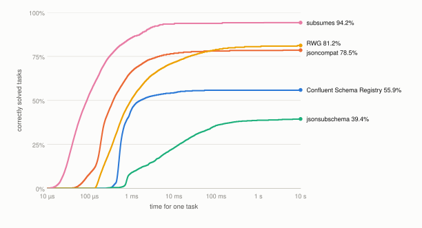

# subsumes-benchmark

A benchmark corpus for JSON Schema inclusion: **does schema A accept every instance valid under schema B?**

It holds 12,039 pairs of draft 2020-12 schemas, most of them with a known answer in both directions. Almost half are built from the official JSON Schema Test Suite, whose instances make the answer known by construction. The others come from the benchmark published with the Refutational Normalization inclusion checker, converted to draft 2020-12. Each pair is stored as one JSON file. The corpus is what [`subsumes`](https://github.com/georg-wolflein/subsumes) is measured against, but nothing in it depends on that library.

## A case

A case is one file, `corpus/schemastore-versions/agripparc-1.2_v1_not_v2.json`. It holds two schemas, `a` and `b`, and what is known about them:

```json
{
  "$schema": "../case.schema.json",
  "a_subsumes_b": true,
  "b_subsumes_a": false,
  "features": ["additionalProperties", "enum", "properties", "type"],
  "upstream": "https://gitlab.lip6.fr/benali1/refutationalnormalizationforjsonschema/-/blob/8064ad83a0dbdb4b02c0ce1632d273f7cbf736cf/src/test/resources/inclusion/schemastore_containment/unknown/agripparc-1.2_v1_not_v2.json",
  "duplicates": [
    "https://gitlab.lip6.fr/benali1/refutationalnormalizationforjsonschema/-/blob/8064ad83a0dbdb4b02c0ce1632d273f7cbf736cf/src/test/resources/inclusion/schemastore_containment/sat/agripparc-1.2_v2_not_v1.json"
  ],
  "derived": { "a_subsumes_b": { "checkers": ["RWG 8064ad8", "jsoncompat 0.6.0", "subsumes 0.2.0"] } },
  "a": { "type": "object", "additionalProperties": false, "properties": { "…": {} } },
  "b": { "type": "object", "additionalProperties": false, "properties": { "…": {} } }
}
```

Every case asks the same question: does `a` accept every instance valid under `b`? If it does, A subsumes B. Every JSON file below the folder of a collection is a case, except the collection's `collection.json`, and its path below `corpus/` without the `.json` is its id. A file is indented, with every non-ASCII character escaped so that none is invisible.

- **`$schema`**: The path to [`corpus/case.schema.json`](corpus/case.schema.json), the schema of a case, for an editor or a validator. The schemas `a` and `b` are draft 2020-12 whatever this says.
- **`a_subsumes_b`**: `true` when `a` accepts every instance valid under `b`, `false` when some instance of `b` is not valid under `a`, `null` when the corpus claims nothing.
- **`b_subsumes_a`**: The same question in the other direction. Upstream answers it for some cases built from the test suite and, as a test of its own, for most cases of the artifact; the other answers are [derived](#derived-labels).
- **`features`**: What the two schemas use, so that cases can be selected and results broken down by it; see [Features](#features).
- **`upstream`**: A permanent link to the file the case comes from, in the source repository at the commit that the collection's `collection.json` names. A case built from the test suite adds a JSON pointer to the test case or the test after a `#`.
- **`duplicates`**: Present only when upstream has these two schemas in other files too, in either order: permanent links to those files, written like `upstream`. The corpus has [one case for all of them](#one-case-for-every-pair-of-schemas).
- **`note`**: Present only when the labels depart from upstream's, and says why.
- **`derived`**: Present only when the case has a label that upstream does not give. It names each such label with what shows it: a `counterexample` for `false`, the `checkers` that agree for `true`; see [Derived labels](#derived-labels).
- **`a`** and **`b`**: The two schemas, last in the file, so that what is known is at the top however long they are.

## Features

`features` lists what `a` and `b` use between them. An entry is a keyword of draft 2020-12 or `recursion`, which is not a keyword:

| Entry | Cases | Meaning |
| --- | --- | --- |
| A keyword, such as `format` or `unevaluatedProperties` | | The keyword occurs where validation can reach it. |
| `recursion` | 562 | A schema is reached again from itself through a reference. |

- **Which keywords.** The 40 that decide what a schema accepts: those of the applicator, unevaluated and validation vocabularies, `format`, `$ref` and `$dynamicRef`. [`corpus/case.schema.json`](corpus/case.schema.json) lists every entry. Left out are the keywords that only name or describe (`$schema`, `$id`, `$anchor`, `$dynamicAnchor`, `$defs`, `$comment`, `title`, `default` and the like), the `content*` keywords, which draft 2020-12 does not assert, and every keyword it does not know.
- **Where a keyword counts.** In the schema itself, in a subschema of a schema that counts, and in the target of a reference in one. A definition that nothing references does not count, and neither does a property that is merely called `format`.
- **Used, not needed.** The list says what is written in the schemas. It does not say that the answer depends on it: deciding that takes an inclusion checker.

The list is generated by the build and sorted by code point. For example, 2,992 cases use `format`, so a checker that treats `format` as an annotation can be measured on the other 9,047.

## What the labels mean

A label holds under these semantics:

- **Draft 2020-12.**
- **`format` is asserted**, not treated as an annotation.
- **Patterns are read as [ECMA-262](https://tc39.es/ecma262/#sec-regexp-regular-expression-objects) regular expressions with the `u` flag**, which is what [the specification recommends](https://json-schema.org/draft/2020-12/json-schema-core#section-6.4). So `\d` and `\w` match ASCII characters only, `.` matches no line terminator, and a character is a code point. A pattern that is not valid with the `u` flag, such as one that escapes a character that needs no escape, has no meaning, and the corpus claims nothing about a case that uses one.

Where an upstream label does not hold under these semantics, the corpus corrects it or withdraws it; see [Departures from upstream](#departures-from-upstream).

Numbers are written as doubles. A question that hinges on digits a double does not hold is not in the corpus.

## Scoring a checker

Run every case whose `a_subsumes_b` is not `null`, and `b_subsumes_a` likewise where it is given:

- A checker is **wrong** when it answers yes and the label is `false`, or no and the label is `true`.
- Declining to answer is never wrong. How often a checker declines, and how long it takes, can be measured on every case, including those labelled `null`.
- A label is upstream's unless the case names it under `derived`. A derived `false` is proven by its counterexample. A derived `true` rests on checkers that agree, so a result on upstream's labels alone leaves the derived ones out.

Every schema stands on its own: a reference resolves inside the schema or to a meta-schema of draft 2020-12, so a checker needs no other document. Where an upstream schema references other documents, they are embedded in it under `$defs`, as [the specification's bundling](https://json-schema.org/draft/2020-12/json-schema-core#section-9.3) does.

## Releases

A release is a tag `v<version>` that carries one file, `corpus.tar.zst`: the `corpus/` folder as a tar archive compressed with Zstandard, about 4 MB.

```bash
curl -fsSLO https://github.com/georg-wolflein/subsumes-benchmark/releases/download/v0.1.0/corpus.tar.zst
zstd -dc corpus.tar.zst | tar -xf -   # unpacks into corpus/
```

With it goes the package `subsumes-benchmark` of that version on PyPI, which holds the same file and [runs a checker](#comparing-checkers) over the corpus. So the corpus can be had without `curl` and `zstd`, and pinned by the version alone:

```bash
uvx subsumes-benchmark==<version> corpus corpus   # unpacks into corpus/
```

The release notes give the SHA-256 of the file. The version says what a change means for someone who measures a checker:

- **Major**: A reader has to change, because the layout, the fields of a case, the form of the case ids or the semantics of the labels changed.
- **Minor**: Results are no longer comparable, because cases were added or removed, or a label or a schema changed.
- **Patch**: Anything else, such as notes, descriptions, documentation and code. That includes the command that runs a checker, and what it asks of an adapter.

Results measured on two versions are comparable exactly when their major and minor numbers match. Before 1.0.0, a minor version may also bring what a major version would.

## Collections

| Collection | Cases | A subsumes B: true / false / unknown | B subsumes A: true / false / unknown | Labels from | Content |
| --- | --- | --- | --- | --- | --- |
| `json-schema-test-suite` | 5,740 | 3,578 / 2,162 / 0 | 1,393 / 4,220 / 127 | construction | Pairs built from the official test suite for draft 2020-12 |
| `synthesized` | 1,296 | 856 / 440 / 0 | 479 / 660 / 157 | construction | Such pairs for drafts 4, 6 and 2019-09, built by others and converted |
| `handwritten-sc` | 138 | 90 / 48 / 0 | 66 / 72 / 0 | construction | Hand-written hard cases |
| `rb-testset` | 292 | 104 / 188 / 0 | 61 / 209 / 22 | upstream tests | The tests of the jsonsubschema tool, some with the documents they reference embedded |
| `mergeallof` | 86 | 83 / 3 / 0 | 79 / 6 / 1 | witness generator | Schemas against a rewriting that merges their `allOf` |
| `schemastore-versions` | 469 | 297 / 76 / 96 | 169 / 71 / 229 | witness generator | Successive versions of real schemas |
| `oneof-as-anyof` | 904 | 230 / 189 / 485 | 315 / 0 / 589 | witness generator | Is `oneOf` used where `anyOf` would be equivalent? |
| `uneval-as-additional` | 297 | 43 / 158 / 96 | 43 / 24 / 230 | witness generator | `unevaluated*` against a translation to `additional*` |
| `additional-as-uneval` | 2,817 | 2,631 / 106 / 80 | 2,682 / 36 / 99 | witness generator | `additional*` against a rewriting through `unevaluated*` |

The counts include the [derived labels](#derived-labels). Each collection folder has a `collection.json` with its description, the source repository and commit, the licence, and where upstream's labels come from:

- **`by-construction`**: The pair was built so that the answer is known.
- **`witness-generator`**: The answer is that of the upstream authors' tool, which is complete but bound by a timeout. Where it gave up, the label is [derived](#derived-labels) or unknown.
- **`upstream-tests`**: The expectations of the jsonsubschema tool's own tests.

### One case for every pair of schemas

Upstream asks many questions twice. The artifact asks most of its questions in both directions, as two tests such as `…_v1_not_v2` and `…_v2_not_v1`, and the suite tests some schemas with the same instance twice. The corpus has one case for every pair of schemas, whichever of the two is `a`, which leaves out 5,144 of the 17,183 cases that upstream gives:

- **Which case is kept.** Of the upstream cases with the same two schemas, the one whose id sorts first. A rebuild keeps the same one.
- **Its labels.** It answers each direction with what any of them says about it. So 3,193 labels of `b_subsumes_a` are upstream's answers to the test that asks the other way. No two of them contradict each other, and the build fails if two ever do.
- **Its notes and `duplicates`.** It has the notes of all of them and lists the upstream files of the others.
- **The same schema twice.** A case whose `a` and `b` are the same schema is a duplicate only of the cases with that schema. Its two directions are one question, and each keeps the label it has.

### Pairs built from the test suite

A test case of the [official JSON Schema Test Suite](https://github.com/json-schema-org/JSON-Schema-Test-Suite) is a schema S with instances that are valid under it or not. The build turns each of the 448 test cases that hold for draft 2020-12 into pairs of six kinds:

- **`valid`**: S against the `const` of one instance. S subsumes it exactly when the instance is valid.
- **`nonvalid`**: `not S` against the same `const`. The answer is the opposite.
- **`unions`**: S against an `anyOf` of the `const` of every valid instance, when there are several.
- **`reflexive`**: S against itself.
- **`universal`**: `true` against `anyOf: [S, not S]`.
- **`unsatisfiable`**: `false` against `allOf: [S, not S]`.

The last three answer both directions. The kinds are those of the [containment test suite](https://github.com/sdbs-uni-p/json-schema-containment-testsuite) of Attouche et al., which built such pairs from the suite as it was in 2021.

The path of a case names the suite's file, the position of the test case in it, the kind, and for `valid` and `nonvalid` the position of the test: `minimum/0/valid/2` is built from the third test of the first test case of `minimum.json`, and `optional/bignum/3/reflexive` from the fourth test case of `optional/bignum.json`. Positions count from zero, like the JSON pointer in `upstream`.

Where S stands inside another schema, it is a copy of S if S neither names a location nor refers to one. Any other S stands under `$defs` once, as a schema resource with an `$id`, and is referenced by that `$id`. It keeps the `$id` it has, or gets `https://subsumes-benchmark.example/schema`.

A test case is not used when it is for other drafts, when it belongs to a proposal, or when it expects `format` to be an annotation. A pair that repeats both schemas of another one is one case, [like every pair of the corpus](#one-case-for-every-pair-of-schemas).

`synthesized` holds the pairs that the containment test suite built for drafts 4, 6 and 2019-09. Its paths have the draft in front and the kind before the keyword: `draft4/valid/minimum/3`. It is largely a near-duplicate of `json-schema-test-suite`, so a report should not add the two up.

## Comparing checkers

The repository also measures open-source inclusion checkers on the corpus: how many tasks each one solves, how often it is wrong, and how long it takes.

<!-- comparison:start -->

<picture>
  <source media="(prefers-color-scheme: dark)" srcset="comparison/chart-dark.svg">
  
</picture>

| Checker | Version | Solved | Wrong yes | Wrong no | Fastest 50% within | Fastest 90% within |
| --- | ---: | ---: | ---: | ---: | ---: | ---: |
| Confluent Schema Registry | 8.4.1 | 50.9% | 533 | 8,228 | 19.1 ms | — |
| jsoncompat (Rust) | 0.6.0 | 70.6% | 0 | 0 | 607 µs | — |
| jsoncompat (Python) | 0.6.0 | 70.6% | 0 | 0 | 961 µs | — |
| jsonsubschema | 0.0.8 | 38.8% | 648 | 2,351 | — | — |
| RWG | 8064ad8 | 84.9% | 530 | 503 | 1.4 ms | — |
| subsumes (Rust) | 0.2.0 | 94.1% | 10 | 11 | 103 µs | 2.1 ms |
| subsumes (Python) | 0.2.0 | 94.1% | 10 | 11 | 174 µs | 3.6 ms |

Measured on corpus `v0.8.0`, all 18,240 tasks, with 10 seconds per task. [The full report](comparison/report.md) has the counts with and without `format`, the collections and how it was measured.

<!-- comparison:end -->

A **task** is one question of the corpus, and every case is two: whether A subsumes B, and whether B subsumes A. The corpus has a label for some tasks and claims nothing about the others. A task is **solved** when the checker gave the answer that the label gives, so only a task with a label can be solved, and the share of solved tasks is a share of those. An answer to a task without a label is counted and not scored, with one exception: where a checker gives a counterexample with its no, a validator is asked whether it is one, and a no with a counterexample that is none is wrong with a label or without. Every checker runs alone on its machine, as one long-running process that is warmed up first, and the time of a task is measured inside that process from the two schemas as text to the answer.

| Checker | Used through | Reads |
| --- | --- | --- |
| [Confluent Schema Registry](https://github.com/confluentinc/schema-registry) | `kafka-json-schema-provider` from Confluent's Maven repository | draft 2020-12 |
| [jsoncompat](https://github.com/ostrowr/jsoncompat) | the crate from crates.io, and the package from PyPI | draft 2020-12 |
| [jsonsubschema](https://github.com/IBM/jsonsubschema) | the package from PyPI | draft-04 |
| [RWG](https://gitlab.lip6.fr/benali1/refutationalnormalizationforjsonschema) | its sources, which are not published as a package | draft-07 |
| [subsumes](https://github.com/georg-wolflein/subsumes) | the crate from crates.io, and the package from PyPI | draft 2020-12 |

A checker that reads an older draft gets every schema rewritten to that draft; where the draft cannot express a schema, the checker is not asked. [`checkers/`](checkers/README.md) has one folder per checker and describes how a checker is plugged in.

The `Comparison` workflow runs every checker over every task after each release, and whenever it is started by hand. It then opens a pull request that updates `comparison/` and the part of this page above. Started by hand with a limit, it runs a sample of that many tasks and publishes nothing, which shows that every checker still builds and answers. To run one checker locally, with its toolchain installed:

```bash
uv run subsumes-benchmark run checkers/jsoncompat --limit 300   # writes results/jsoncompat/
uv run --extra report subsumes-benchmark report results --out /tmp/comparison
```

Whoever develops a checker can hold the run of a change against the run of what the change is based on:

```bash
uv run subsumes-benchmark diff results/jsoncompat --base base/jsoncompat --out comment.md
```

A run is two files in its folder: `results.jsonl` with one line per task, which [`schemas/result.schema.json`](schemas/result.schema.json) describes, and `run.json` with what ran and under which limits, which [`schemas/run.schema.json`](schemas/run.schema.json) describes.

The `diff` above writes a comment for a pull request: the answers by collection with what changed, the wrong answers, the tasks that the base answered and the change does not, those it answers newly, and the kinds of reason for declining. The command fails when an answer is wrong, when a task ended in an error, a crash or a timeout, and when a task of the base is no longer answered, unless `--allow-lost` accepts that.

The command is also a package on PyPI, [`subsumes-benchmark`](https://pypi.org/project/subsumes-benchmark/), for a checker that lives in another repository: `uvx subsumes-benchmark==<version> corpus corpus` unpacks the corpus of that version, which the package holds, and `uvx subsumes-benchmark==<version> run path/to/checker` runs the adapter in that folder over it.

## Departures from upstream

The corpus leaves out 12 cases of the inclusion artifact and 23 test cases of the test suite. [`overrides.json`](overrides.json) lists them with the reason:

| Reason | Left out |
| --- | --- |
| A schema is not valid draft 2020-12, also where only a keyword that asserts nothing has a value of the wrong type, such as `deprecated` | 6 cases of `additional-as-uneval`, 2 of `oneof-as-anyof` and 4 of `schemastore-versions` |
| The schema declares another dialect, or references a schema of an older draft | 6 test cases |
| The schema references a document by a URL other than the document's `$id`, which a schema that stands on its own cannot express | 2 test cases |
| The expected results are not those of draft 2020-12 with `format` asserted: `dependencies` still working, an unknown format | 8 test cases |
| The test case tells numbers apart by digits that a double does not hold | 7 test cases |

Every schema that is in the corpus is therefore valid, and every reference in it resolves. The schema of a case says the first: it requires `a` and `b` to be valid under the metaschema of draft 2020-12.

The same file lists every case whose labels differ from upstream's, with the reason, which is copied into the case's `note`. For a case built from the test suite, upstream's label is what the suite's expected result gives. There are 72 such upstream cases, which are 50 cases of the corpus:

| Reason | Cases | What the corpus does |
| --- | --- | --- |
| A pattern is not valid in ECMA-262 with the `u` flag | 60 | Claims nothing |
| Upstream's label does not hold | 2 | Claims nothing |
| Upstream's label holds only if `format` is an annotation | 6 | Claims nothing |
| Upstream's label holds only if `.` matches a line terminator | 4 | Corrects all 4 |

Two limits remain:

- **Patterns.** 3,521 cases with a label of upstream's use patterns. In 439 of them `b` only lists its instances, so the label can be checked by validating those instances against `a`; the tests do that with an ECMA-262 engine and `format` asserted, for these and for 4,822 such cases without patterns. Another 120 compare a schema of the test suite with itself or its negation, which holds in any dialect. The other 2,962 come with labels from upstream tools that read patterns in their own dialect. They are kept as they are until a checker disagrees and the dialect turns out to be the reason. A derived label does not have this limit: it is `false` by a counterexample that the same engine confirms, or the schemas use no pattern.
- **Formats.** Upstream's witness generator asserts only a few formats. A label of a `witness-generator` collection that hinges on a format may therefore not hold with every format asserted; six such cases are known and listed.

## Derived labels

Upstream leaves questions open. Its witness generator gave up on 3,188 of its tests, and for many pairs upstream asks one direction only. Where checkers settle such a question, the corpus has a label for it. [`derived.json`](derived.json) lists these labels, each with what shows it, and the case repeats that under `derived`:

| Label | Shown by | Labels |
| --- | --- | ---: |
| `false` | A counterexample: an instance that is valid under the schema whose instances must be accepted and not valid under the other. Two validators that share no code must both say so: the one of the tests, which reads patterns as ECMA-262 does, and `jsonschema-rs`. That is a proof, whichever checker found the instance. | 5,141 |
| `true` | Two or more checkers that say yes, where none says no and the schemas use neither a pattern nor a format, nor a number that a double does not hold. That is evidence and no proof. | 1,788 |

For example, `corpus/additional-as-uneval/o21764.original_not_unevalEliminated.json` and `corpus/additional-as-uneval/o69207.original_not_unevalEliminated.json` have:

```json
"derived": {"a_subsumes_b": {"counterexample": {"$schema": "", "encoding": {}, "mark": "box-plot"}}}
"derived": {"a_subsumes_b": {"checkers": ["jsoncompat 0.6.0", "subsumes 0.2.0"]}}
```

- **No label rests on one checker.** One checker's yes is never a label, and neither is a no without an instance that proves it.
- **Patterns and formats.** Checkers read these in their own ways: subsumes 0.2.0, whose answers these are, read a pattern in the dialect of the Rust `regex` crate, in which `\d` matches every digit of Unicode, and RWG takes `format` for an annotation. Their yes is then the answer to another question, so no `true` is derived for schemas that use either. A counterexample is held against the schemas as the corpus reads them, so a `false` is derived for those too.
- **Numbers.** A question that hinges on digits that a double does not hold is not in the corpus. So a counterexample holds only numbers that a double holds, and it must refute the schemas also as someone reads them who reads every number as a double.
- **Overrides.** A case that `overrides.json` lists keeps the labels that the override states, also where it claims nothing.
- **The same schema twice.** The two directions of a case whose `a` and `b` are the same schema are one question, so the other direction is not asked again and keeps the label it has.
- **A proof replaces an agreement.** `derive` reads the file as it reads a run, so a later run adds labels, and a counterexample for a label that is `true` makes it `false`.

Of the derived labels, 629 say whether A subsumes B and 6,300 whether B subsumes A. What became of the open questions of each collection:

| Collection | Open questions | Derived `true` | Derived `false` | Still open |
| --- | ---: | ---: | ---: | ---: |
| `additional-as-uneval` | 179 | 2 | 6 | 171 |
| `json-schema-test-suite` | 4,499 | 154 | 4,218 | 127 |
| `oneof-as-anyof` | 1,658 | 544 | 45 | 1,069 |
| `rb-testset` | 269 | 57 | 206 | 6 |
| `schemastore-versions` | 626 | 466 | 0 | 160 |
| `synthesized` | 1,173 | 479 | 658 | 36 |
| `uneval-as-additional` | 417 | 86 | 8 | 323 |
| All | 8,821 | 1,788 | 5,141 | 1,892 |

The questions that are still open:

| Why | Questions |
| --- | ---: |
| Two checkers say yes, and the schemas use a pattern, a format or a number that a double does not hold | 1,286 |
| The corpus cannot say what a schema accepts: a pattern is not valid, or a format is none of draft 2020-12 | 309 |
| No checker says yes or no | 145 |
| One checker says yes and no other does | 139 |
| An override states the labels of the case, also where it claims nothing | 8 |
| A checker says no, and no instance it gave proves it | 5 |

The labels come from three runs: subsumes 0.2.0 with 100 times its default work budget and jsoncompat 0.6.0, both over every open question, and the answers of RWG in the comparison of v0.8.0, which asked A subsumes B only. `comparison.tar.zst` of a release holds the runs of its comparison. To derive labels again, with the toolchains of the checkers installed:

```bash
SUBSUMES_BUDGET=1000000000 uv run subsumes-benchmark run checkers/subsumes --unlabelled --warmup 0 --jobs 8 --timeout 1800 --out results/unlabelled
uv run subsumes-benchmark run checkers/jsoncompat --unlabelled --warmup 0 --jobs 2 --timeout 60 --out results/unlabelled
uv run subsumes-benchmark derive results/unlabelled/subsumes results/unlabelled/jsoncompat   # and the folder of any other run
make corpus
```

A run reads the corpus while it works, so the corpus is rebuilt only after the last run has ended.

## How the sources are converted

The pairs of `json-schema-test-suite` are built as [described above](#pairs-built-from-the-test-suite). The suite gives the documents that a schema references next to it, by URL; they are embedded like those of the artifact. The inclusion artifact stores each test as one fused document, `{"allOf": [S1, {"not": S2}]}`, with both sides' definitions hoisted to the top level, every other pointer prefixed with its path in the fused document, and the answer given by the directory (`sat`, `unsat` or `unknown`). The build undoes each step and then converts each side to draft 2020-12:

- `definitions` and the hoisted groups become one `$defs`.
- Array-form `items` becomes `prefixItems`, and `additionalItems` becomes `items`.
- `dependencies` splits into `dependentRequired` and `dependentSchemas`.
- A draft-04 `id: "#name"` becomes `$anchor`; other identifiers are dropped, except an absolute root `$id`. Both upstream tools resolve `#/...` pointers against the document root, which is what a draft 2020-12 document without embedded resources does.
- Every JSON-pointer reference is mapped to where its target moved, so `#/items/0` becomes `#/prefixItems/0`.
- A document that a schema references is embedded in it under `$defs`, named by its URL and with that URL as its `$id`, together with the documents that it references in turn. No reference changes. A reference to the URL of the schema itself stays a reference to the schema.
- Unknown keywords and `format` are kept as written.

The artifact lists the narrower schema first, so `b` is its first schema and `a` its second. In `agripparc-1.2_v1_not_v2`, `b` is version 1 and `a` is version 2.

## Repository layout

| Path | Content |
| --- | --- |
| `corpus/` | The corpus: generated, committed, never edited by hand |
| `collections.json` | The collections and the upstream dataset each is built from |
| `overrides.json` | Every departure from upstream, with the reason: the cases left out and the labels changed |
| `derived.json` | The labels that upstream does not give, each with what shows it; written by `subsumes-benchmark derive` |
| `schemas/` | The schemas of a case, of `collections.json`, of `overrides.json`, of `derived.json` and of a checker's `checker.json`, of the three lines of the protocol between the runner and an adapter, and of the two files of a run. They say what each key means. The corpus carries a copy of the first |
| `src/subsumes_benchmark/generated/` | The Pydantic models that read the files those schemas describe: generated from the schemas, never edited by hand |
| `sources/` | The upstream repositories as submodules, fetched only to rebuild |
| `src/subsumes_benchmark/` | The build: `testsuite`, `unfuse`, `convert`, `features`, `derived`, `build`. And `validation`, which validates an instance the way the corpus reads a schema |
| `src/subsumes_benchmark/compare/` | The comparison: running a checker over the tasks, and the report. And `derive`, which derives labels from runs over the questions without one |
| `checkers/` | One folder per checker of the comparison, with the adapter that makes it answer |
| `comparison/` | The latest published report, written by the `Comparison` workflow |
| `tests/` | The layout of the corpus, the validity of its schemas, the features of its cases, the labels that can be checked, the counterexamples of the derived ones |

## Rebuilding the corpus

```bash
uv sync
make sources   # fetches the two upstream repositories, about 900 MB
make corpus    # about 15 seconds
```

The submodules under `sources/` are marked `update = none`, so cloning this repository, even recursively, does not fetch them; `make sources` does. Their commits pin what the corpus is built from. The build needs Pydantic, which reads the configuration files, and otherwise nothing but the standard library. It reads `derived.json` as it is and runs no checker.

## Development

```bash
uv sync
make ci            # ruff check, ruff format --check, ty check, check-jsonschema, datamodel-codegen --check, cargo fmt --check, cargo clippy, pytest
make format        # apply ruff's fixes and formatting, and cargo fmt
make models        # rewrite the generated models after a change to a schema of a configuration file
```

`make ci` covers the adapters under `checkers/` too, so it needs `cargo`. The Rust adapters are formatted by `cargo fmt` and linted by `cargo clippy`. The Python adapters are linted and formatted by ruff with everything else, and type-checked by ty, each against the environment its script declares.

CI runs the same on every push and pull request. The tests read every case of the committed corpus, which takes under a minute: each case matches the schema of a case, which says that its two schemas are valid draft 2020-12, every reference resolves, every case lists the features of its schemas, every label that validation can check holds, and every counterexample of a derived label refutes.

Releases are made by [release-please](https://github.com/googleapis/release-please). It keeps one pull request open, `chore(main): release <version>`, that raises the version in `pyproject.toml` and `uv.lock` and lists what the release holds. Merging that pull request publishes the release: the `Release` workflow tags the merged commit `v<version>`, packs the archive, publishes the package with the archive in it to PyPI, and attaches the archive to the release. Not every commit on `main` is released; the pull request waits and takes in what is merged meanwhile.

The titles of the pull requests merged since the last release decide the version. So the type in a title follows what the change does to the corpus, by the versioning [above](#releases), and not why it was made:

| Title | Version | For |
| --- | --- | --- |
| `feat!:`, or another type with `!` | Major, or minor before 1.0.0 | A change that a reader has to follow |
| `feat:` | Minor | A change to a label, a schema or the set of cases, also where it corrects a mistake |
| `fix:`, `perf:`, `revert:` | Patch | Anything else that is worth a release |

A pull request of another type, such as `docs`, `ci` or `chore`, opens no release pull request; it goes out with the next release. A pull request is squash-merged with its description as the body of the commit, and release-please reads that too: a last line `Release-As: 1.0.0` in a description sets the next version outright.

## Credits and licences

The code in this repository is MIT licensed, except [`checkers/rwg/`](checkers/rwg), which is compiled together with RWG and is GPL-3.0 like it. The corpus keeps the licences of its sources, which each `collection.json` names; the licence texts are in [`corpus/licenses/`](corpus/licenses). The package on PyPI holds the code and the corpus, so it is licensed `MIT AND GPL-3.0-only` and carries those texts.

`json-schema-test-suite` is built from [json-schema-org/JSON-Schema-Test-Suite](https://github.com/json-schema-org/JSON-Schema-Test-Suite) (MIT, Julian Berman). The kinds of pairs are those of [sdbs-uni-p/json-schema-containment-testsuite](https://github.com/sdbs-uni-p/json-schema-containment-testsuite) (Stefanie Scherzinger, University of Passau), described in Lyes Attouche, Mohamed-Amine Baazizi, Dario Colazzo, Yunchen Ding, Michael Fruth, Giorgio Ghelli, Carlo Sartiani and Stefanie Scherzinger, *A Test Suite for JSON Schema Containment*, ER 2021 Demos and Posters, CEUR Workshop Proceedings 2958. Until version 0.4.0 the corpus took that suite's draft 2020-12 pairs as they were.

The eight other collections come from the artifact of Mohamed-Amine Baazizi, Nour El Houda Ben Ali, Dario Colazzo, Giorgio Ghelli, Stefan Klessinger, Carlo Sartiani and Stefanie Scherzinger, *JSON Schema Inclusion through Refutational Normalization: Reconciling Efficiency and Completeness* ([arXiv:2603.25306](https://arxiv.org/abs/2603.25306), 2026), at [gitlab.lip6.fr/benali1/refutationalnormalizationforjsonschema](https://gitlab.lip6.fr/benali1/refutationalnormalizationforjsonschema), GPL-3.0. Five of them were assembled for *Witness Generation for JSON Schema* (Lyes Attouche, Mohamed-Amine Baazizi, Dario Colazzo, Giorgio Ghelli, Carlo Sartiani and Stefanie Scherzinger, PVLDB 15(13), 2022; reproduction package [sdbs-uni-p/JSONSchemaWitnessGeneration](https://github.com/sdbs-uni-p/JSONSchemaWitnessGeneration)) and *Witness Generation for Classical JSON Schema* (same authors, ACM TODS 51(4), 2026). The schemas inside come from [IBM/jsonsubschema](https://github.com/IBM/jsonsubschema)'s tests (Apache-2.0; Andrew Habib, Avraham Shinnar, Martin Hirzel and Michael Pradel, *Finding Data Compatibility Bugs with JSON Subschema Checking*, ISSTA 2021), from [SchemaStore](https://github.com/SchemaStore/schemastore) (Apache-2.0), from the official JSON Schema Test Suite (MIT), from schemas found on GitHub, and from the authors' own hand-written cases. The documents that `rb-testset` references (Snowplow Iglu Central and Washington Post ANS schemas) come from the artifact's cache and are embedded in the schemas that reference them.
