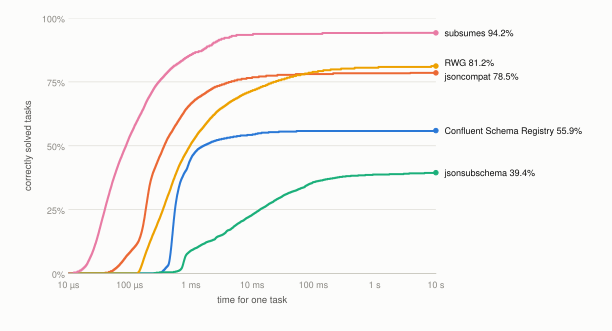

# Comparison of inclusion checkers

Corpus `v0.5.0-7-g6e2be6c29`, all 18,262 tasks, of which 15,094 have a label. Each checker had 10 seconds per task. Run on 2026-11-18 on AMD EPYC 7763 64-Core Processor (Linux-7.0.0-1019-azure-x86_64-with-glibc2.43).

<picture>
  <source media="(prefers-color-scheme: dark)" srcset="chart-dark.svg">
  
</picture>

A task asks whether one schema accepts every instance valid under another. A task is **solved** when the checker answered yes or no and no label of the corpus contradicts the answer. A checker that declines is never wrong; a checker that can only say yes or no is wrong wherever its no meets a label that says yes.

## Outcomes

| Checker | Solved | Correct | Answered, no label | Wrong no | Wrong yes | No answer | Timed out |
| --- | ---: | ---: | ---: | ---: | ---: | ---: | ---: |
| Confluent Schema Registry | 50.7% | 6,154 | 3,105 | 8,267 | 533 | 199 | 4 |
| jsoncompat (Rust) | 70.5% | 10,800 | 2,068 | 11 | 12 | 5,366 | 5 |
| jsoncompat (Python) | 70.5% | 10,802 | 2,067 | 11 | 12 | 5,365 | 5 |
| jsonsubschema | 39.0% | 5,784 | 1,335 | 2,360 | 641 | 7,986 | 156 |
| RWG | 84.9% | 12,591 | 2,922 | 507 | 537 | 1,400 | 305 |
| subsumes | 94.2% | 14,169 | 3,032 | 1 | 1 | 1,059 | 0 |

- **Correct**: the answer is the label.
- **Answered, no label**: the checker answered and the corpus claims nothing.
- **Wrong no**: the checker said no where the label says that A subsumes B.
- **Wrong yes**: the checker said yes where the label says that it does not.
- **No answer**: the checker declined, failed, or cannot read the schemas.
- **Timed out**: no answer within the time.

### With and without `format`

The labels hold with `format` asserted. A checker that treats `format` as an annotation, or does not know it, answers a different question on the tasks that use it, so the same counts follow for the two kinds of task.

The 14,141 tasks whose schemas do not use `format`:

| Checker | Solved | Correct | Answered, no label | Wrong no | Wrong yes | No answer | Timed out |
| --- | ---: | ---: | ---: | ---: | ---: | ---: | ---: |
| Confluent Schema Registry | 52.1% | 4,984 | 2,384 | 6,563 | 39 | 167 | 4 |
| jsoncompat (Rust) | 76.7% | 8,819 | 2,027 | 11 | 12 | 3,267 | 5 |
| jsoncompat (Python) | 76.7% | 8,818 | 2,026 | 11 | 12 | 3,269 | 5 |
| jsonsubschema | 43.9% | 4,939 | 1,269 | 2,006 | 130 | 5,730 | 67 |
| RWG | 88.5% | 10,242 | 2,274 | 14 | 44 | 1,395 | 172 |
| subsumes | 98.4% | 11,569 | 2,342 | 1 | 1 | 228 | 0 |

The 4,121 tasks whose schemas use `format`:

| Checker | Solved | Correct | Answered, no label | Wrong no | Wrong yes | No answer | Timed out |
| --- | ---: | ---: | ---: | ---: | ---: | ---: | ---: |
| Confluent Schema Registry | 45.9% | 1,170 | 721 | 1,704 | 494 | 32 | 0 |
| jsoncompat (Rust) | 49.1% | 1,981 | 41 | 0 | 0 | 2,099 | 0 |
| jsoncompat (Python) | 49.1% | 1,984 | 41 | 0 | 0 | 2,096 | 0 |
| jsonsubschema | 22.1% | 845 | 66 | 354 | 511 | 2,256 | 89 |
| RWG | 72.7% | 2,349 | 648 | 493 | 493 | 5 | 133 |
| subsumes | 79.8% | 2,600 | 690 | 0 | 0 | 831 | 0 |

## Time

| Checker | Solved | Median solved task | Fastest 50% of all tasks within | Fastest 90% of all tasks within | Slowest solved task | Whole run |
| --- | ---: | ---: | ---: | ---: | ---: | ---: |
| Confluent Schema Registry | 50.7% | 717 µs | 40.5 ms | — | 7.9 s | 4 min |
| jsoncompat (Rust) | 70.5% | 336 µs | 763 µs | — | 4.0 s | 7 min |
| jsoncompat (Python) | 70.5% | 541 µs | 1.3 ms | — | 3.5 s | 8 min |
| jsonsubschema | 39.0% | 6.6 ms | — | — | 9.9 s | 52 min |
| RWG | 84.9% | 708 µs | 1.1 ms | — | 9.9 s | 66 min |
| subsumes | 94.2% | 112 µs | 126 µs | 2.7 ms | 1.2 s | 4 min |

The time of a task is measured inside the checker's process, from the two schemas as text to the answer, after 200 unmeasured tasks to warm up. Reading the files, starting the process and rewriting a schema for an older draft are not in it. A share of all tasks that a checker did not reach has no time (—).

## Collections

The share of each collection's tasks that a checker solved.

| Collection | Tasks | Confluent Schema Registry | jsoncompat (Rust) | jsoncompat (Python) | jsonsubschema | RWG | subsumes |
| --- | ---: | ---: | ---: | ---: | ---: | ---: | ---: |
| `additional-as-uneval` | 5,694 | 11.5% | 40.3% | 40.3% | 40.2% | 97.8% | 98.4% |
| `handwritten-sc` | 282 | 51.8% | 35.1% | 35.1% | 49.3% | 99.3% | 100.0% |
| `json-schema-test-suite` | 6,995 | 54.8% | 94.8% | 94.8% | 30.1% | 65.6% | 87.1% |
| `mergeallof` | 174 | 37.4% | 73.0% | 73.0% | 62.6% | 98.9% | 100.0% |
| `oneof-as-anyof` | 1,822 | 98.7% | 56.2% | 56.3% | 18.0% | 94.1% | 97.2% |
| `rb-testset` | 300 | 92.0% | 72.3% | 72.3% | 92.7% | 97.0% | 99.3% |
| `schemastore-versions` | 1,056 | 99.0% | 92.6% | 92.5% | 80.8% | 99.5% | 100.0% |
| `synthesized` | 1,331 | 63.9% | 88.5% | 88.5% | 52.5% | 98.6% | 100.0% |
| `uneval-as-additional` | 608 | 96.7% | 52.6% | 52.5% | 52.0% | 88.5% | 97.7% |

## Where no answer came

| Checker | Declined | Not asked | Failed | Crashed | Timed out |
| --- | ---: | ---: | ---: | ---: | ---: |
| Confluent Schema Registry | 0 | 0 | 199 | 0 | 4 |
| jsoncompat (Rust) | 4,881 | 0 | 479 | 6 | 5 |
| jsoncompat (Python) | 4,880 | 0 | 479 | 6 | 5 |
| jsonsubschema | 0 | 1,780 | 6,206 | 0 | 156 |
| RWG | 0 | 1,241 | 159 | 0 | 305 |
| subsumes | 1,059 | 0 | 0 | 0 | 0 |

- **Declined**: the checker ran and said that it does not know.
- **Not asked**: the checker reads an older draft, and that draft cannot express one of the schemas.
- **Failed**: the checker raised an error or rejected a schema.
- **Crashed**: the checker's process died.

## Variants

- jsoncompat (Rust) and jsoncompat (Python) gave the same answer on 18,247 of 18,262 tasks. A timeout or a crash on one side accounts for 0 of the 15 others.

## What ran

| Checker | Version | Reads | Source |
| --- | --- | --- | --- |
| Confluent Schema Registry | 8.4.1 | draft 2020-12 | <https://github.com/confluentinc/schema-registry> |
| jsoncompat (Rust) | 0.6.0 | draft 2020-12 | <https://github.com/ostrowr/jsoncompat> |
| jsoncompat (Python) | 0.6.0 | draft 2020-12 | <https://github.com/ostrowr/jsoncompat> |
| jsonsubschema | 0.0.8 | draft-04 | <https://github.com/IBM/jsonsubschema> |
| RWG | 8064ad8 | draft-07 | <https://gitlab.lip6.fr/benali1/refutationalnormalizationforjsonschema> |
| subsumes | 0.1.0 | draft 2020-12 | <https://github.com/georg-wolflein/subsumes> |

- **Older drafts.** A checker that does not read draft 2020-12 gets every schema rewritten to its draft, with references resolved and keywords renamed. Nothing is encoded by other means: where the older draft lacks a keyword, the checker is not asked.
- **Labels.** Most labels of five collections come from the witness generator that RWG succeeds, so they favour RWG by construction.
- **subsumes.** subsumes is by the author of the corpus and is developed against it, so it does not meet these tasks for the first time as the other checkers do.
- **Duplicates.** `synthesized` largely repeats `json-schema-test-suite`, so the two should not be read as independent evidence.
